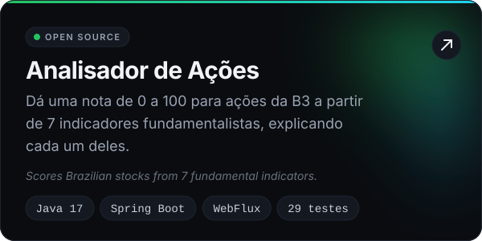

<picture>
  <source media="(prefers-color-scheme: dark)" srcset="assets/header-dark.svg">
  <source media="(prefers-color-scheme: light)" srcset="assets/header-light.svg">
  
</picture>

  
  

### Sobre

Gosto de transformar problemas reais em produto. Hoje estudo e construo **sistemas
multiagente**: vários agentes de IA trabalhando juntos, usando ferramentas de verdade, com
uma pessoa aprovando o que importa.

I turn real problems into products. Today I study and build <b>multi-agent systems</b>: AI agents working together with real tools, with a human approving what matters.

 

### Projetos

  <picture><source media="(prefers-color-scheme: dark)" srcset="assets/card-maestro-dark.svg"><source media="(prefers-color-scheme: light)" srcset="assets/card-maestro-light.svg"></picture>
  <picture><source media="(prefers-color-scheme: dark)" srcset="assets/card-chorus-dark.svg"><source media="(prefers-color-scheme: light)" srcset="assets/card-chorus-light.svg"></picture>

  <picture><source media="(prefers-color-scheme: dark)" srcset="assets/card-lastro-dark.svg"><source media="(prefers-color-scheme: light)" srcset="assets/card-lastro-light.svg"></picture>
  <a href="https://github.com/gmhenriquested/analisador-acoes"><picture><source media="(prefers-color-scheme: dark)" srcset="assets/card-analisador-dark.svg"><source media="(prefers-color-scheme: light)" srcset="assets/card-analisador-light.svg"></picture></a>

Maestro, Chorus e Lastro estão em repositórios privados. Código e demo sob consulta. · <i>Private repos, code and demo on request.</i>

 

### Stack

<table>
  <tr>
    <td width="150"><b>Backend</b></td>
    <td><picture><source media="(prefers-color-scheme: dark)" srcset="https://skillicons.dev/icons?i=java%2Cspring%2Cmaven%2Cpython%2Cfastapi%2Cnodejs&theme=dark"><source media="(prefers-color-scheme: light)" srcset="https://skillicons.dev/icons?i=java%2Cspring%2Cmaven%2Cpython%2Cfastapi%2Cnodejs&theme=light"></picture> Spring Data JPA · Spring Security · WebFlux · Thymeleaf · SQLAlchemy · Zod</td>
  </tr>
  <tr>
    <td><b>Frontend</b></td>
    <td><picture><source media="(prefers-color-scheme: dark)" srcset="https://skillicons.dev/icons?i=ts%2Cjs%2Creact%2Cnextjs%2Ctailwind%2Chtml%2Ccss&theme=dark"><source media="(prefers-color-scheme: light)" srcset="https://skillicons.dev/icons?i=ts%2Cjs%2Creact%2Cnextjs%2Ctailwind%2Chtml%2Ccss&theme=light"></picture></td>
  </tr>
  <tr>
    <td><b>IA</b></td>
    <td><picture><source media="(prefers-color-scheme: dark)" srcset="assets/ia-logos-dark.svg"><source media="(prefers-color-scheme: light)" srcset="assets/ia-logos-light.svg"></picture> Claude · ChatGPT · Gemini · Copilot · Perplexity · DeepSeek · Grok · MCP Claude Agent SDK · Composio · sistemas multiagente</td>
  </tr>
  <tr>
    <td><b>Dados e infra</b></td>
    <td><picture><source media="(prefers-color-scheme: dark)" srcset="https://skillicons.dev/icons?i=postgres%2Csqlite%2Cdocker%2Cgit%2Cgithub%2Cgithubactions&theme=dark"><source media="(prefers-color-scheme: light)" srcset="https://skillicons.dev/icons?i=postgres%2Csqlite%2Cdocker%2Cgit%2Cgithub%2Cgithubactions&theme=light"></picture> Drizzle ORM · Alembic · Neon</td>
  </tr>
  <tr>
    <td><b>Testes</b></td>
    <td>JUnit 5 · Mockito · AssertJ · JaCoCo · pytest</td>
  </tr>
  <tr>
    <td><b>No dia a dia</b></td>
    <td><picture><source media="(prefers-color-scheme: dark)" srcset="https://skillicons.dev/icons?i=idea%2Cobsidian&theme=dark"><source media="(prefers-color-scheme: light)" srcset="https://skillicons.dev/icons?i=idea%2Cobsidian&theme=light"></picture></td>
  </tr>
</table>

 

### Agora

- Levando o **Maestro** do ambiente de teste para apps reais: e-mail, CRM e banco.
- Construindo meu site de portfólio. <i>Building my portfolio website.</i>
