<picture>
  <source media="(prefers-color-scheme: dark)" srcset="assets/header-dark.svg">
  <source media="(prefers-color-scheme: light)" srcset="assets/header-light.svg">
  
</picture>

  
  

Gosto de transformar problemas reais em produto. Hoje meu foco está em **sistemas
multiagente**: vários agentes de IA trabalhando juntos, usando ferramentas reais, com uma
pessoa aprovando o que importa. No backend uso **Java e Spring Boot**; no front,
**TypeScript e Next.js**.

I turn real problems into products. My focus today is <b>multi-agent systems</b>: AI agents working together with real tools, with a human approving what matters. Backend in Java and Spring Boot, frontend in TypeScript and Next.js.

 

### Projetos · Projects

<table>
  <tr>
    <td width="50%" valign="top">
      <b>Maestro</b>&nbsp;&nbsp;<code>Next.js</code> <code>TypeScript</code> <code>Claude Agent SDK</code>
        
      Uma equipe de agentes de IA que toca o dia a dia de uma empresa. Cada agente tem seu papel, eles passam tarefas entre si e pedem aprovação antes de mexer com dinheiro.
        
      <i>A team of AI agents that runs a company's day to day, with human approval on money decisions.</i>
    </td>
    <td width="50%" valign="top">
      <b>Chorus</b>&nbsp;&nbsp;<code>Next.js</code> <code>MCP</code> <code>Composio</code>
        
      Um espaço onde os agentes de IA de um time trabalham juntos usando os apps que o time já usa, como GitHub, Slack e Jira.
        
      <i>A shared workspace where a team's AI agents collaborate inside the tools the team already uses.</i>
    </td>
  </tr>
  <tr>
    <td width="50%" valign="top">
      <b>Lastro</b>&nbsp;&nbsp;<code>Python</code> <code>PostgreSQL</code>
        
      Ajuda empresas sem time fiscal a cumprir o novo split payment da Reforma Tributária (IBS/CBS), com garantia em caso de erro.
        
      <i>Tax compliance for Brazil's new split payment system, backed by insurance.</i>
    </td>
    <td width="50%" valign="top">
      <a href="https://github.com/gmhenriquested/analisador-acoes"><b>Analisador de Ações</b></a>&nbsp;&nbsp;<code>Java 17</code> <code>Spring Boot</code> <code>29 testes</code>
        
      Dá uma nota de 0 a 100 para ações da B3 a partir de 7 indicadores fundamentalistas, com explicação de cada um.
        
      <i>Scores Brazilian stocks from 7 fundamental indicators. Open source.</i>
    </td>
  </tr>
</table>

Maestro, Chorus e Lastro estão em desenvolvimento em repositórios privados. Código e demo sob consulta. · <i>Private repos, code and demo on request.</i>

 

### Ferramentas · Stack

<picture>
  <source media="(prefers-color-scheme: dark)" srcset="https://skillicons.dev/icons?i=java,spring,ts,nextjs,react,python,postgres,docker,git&theme=dark&perline=9">
  <source media="(prefers-color-scheme: light)" srcset="https://skillicons.dev/icons?i=java,spring,ts,nextjs,react,python,postgres,docker,git&theme=light&perline=9">
  
</picture>

 

### Agora · Now

- Levando o **Maestro** do ambiente de teste para apps reais: e-mail, CRM e banco.
- Construindo meu site de portfólio. <i>Building my portfolio website.</i>
