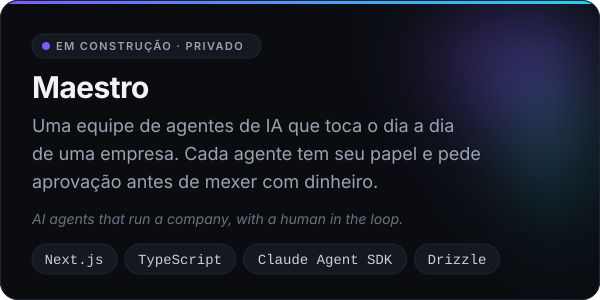
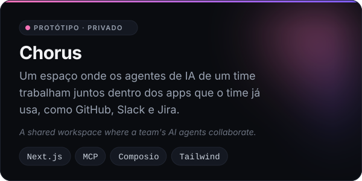
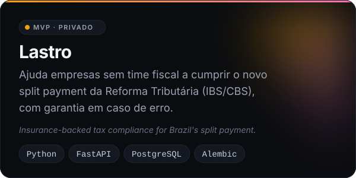

<picture>
  <source media="(prefers-color-scheme: dark)" srcset="assets/header-dark.svg">
  <source media="(prefers-color-scheme: light)" srcset="assets/header-light.svg">
  
</picture>

  <samp>
    <a href="https://www.linkedin.com/in/gabriel-medeiros-henriques">linkedin</a> ·
    <a href="mailto:gabrielmhenriques15@gmail.com">e-mail</a> ·
    <a href="#projetos">projetos</a> ·
    <a href="#stack">stack</a> ·
    <a href="https://github.com/gmhenriquested/analisador-acoes">open source</a>
  </samp>

 

Estudo Engenharia de Software no IBMEC e construo produtos com **agentes de IA**: sistemas
em que vários agentes trabalham juntos, usam ferramentas de verdade e pedem aprovação de
uma pessoa no que importa. No backend uso **Java e Spring Boot**; no front, **TypeScript e Next.js**.

<i>Software Engineering student at IBMEC building products with AI agents: multi-agent systems that use real tools, with a human approving what matters.</i>

 

### <samp>projetos</samp>

  <picture><source media="(prefers-color-scheme: dark)" srcset="assets/card-maestro-dark.svg"><source media="(prefers-color-scheme: light)" srcset="assets/card-maestro-light.svg"></picture>
  <picture><source media="(prefers-color-scheme: dark)" srcset="assets/card-chorus-dark.svg"><source media="(prefers-color-scheme: light)" srcset="assets/card-chorus-light.svg"></picture>

  <picture><source media="(prefers-color-scheme: dark)" srcset="assets/card-lastro-dark.svg"><source media="(prefers-color-scheme: light)" srcset="assets/card-lastro-light.svg"></picture>
  <a href="https://github.com/gmhenriquested/analisador-acoes"><picture><source media="(prefers-color-scheme: dark)" srcset="assets/card-analisador-dark.svg"><source media="(prefers-color-scheme: light)" srcset="assets/card-analisador-light.svg"></picture></a>

Maestro, Chorus e Lastro estão em repositórios privados. Código e demo sob consulta. · <i>Private repos, code and demo on request.</i>

 

### <samp>stack</samp>

<picture><source media="(prefers-color-scheme: dark)" srcset="assets/stack-dark.svg"><source media="(prefers-color-scheme: light)" srcset="assets/stack-light.svg"></picture>

 

### <samp>agora</samp>

<samp>nov 2026</samp>&nbsp; Levando o **Maestro** do ambiente de teste para apps reais: e-mail, CRM e banco. 
<samp>nov 2026</samp>&nbsp; Construindo meu site de portfólio.

 

  <samp>
    <a href="https://www.linkedin.com/in/gabriel-medeiros-henriques">linkedin</a> ·
    <a href="mailto:gabrielmhenriques15@gmail.com">e-mail</a> ·
    <a href="#projetos">projetos</a> ·
    <a href="#stack">stack</a> ·
    <a href="https://github.com/gmhenriquested/analisador-acoes">open source</a>
  </samp>

